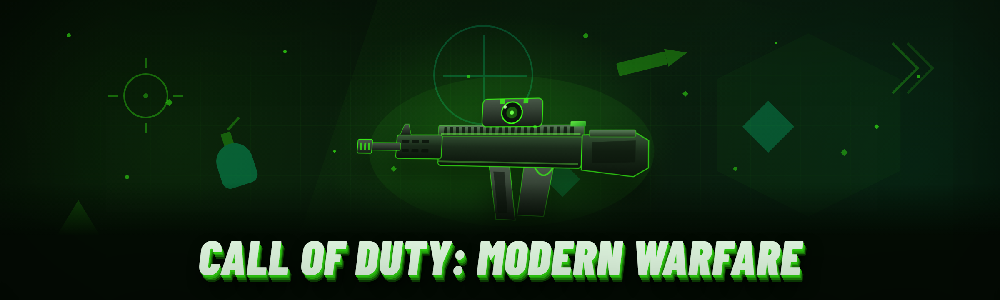

  
  
  

  

  
  

---

-red?style=plastic)

---

## 🎯 Module Status Board

Every single module below was smoke-tested against the current MW4 2026 retail build before this README was committed. Green means I ran it, saw it work, and left it in the release. Yellow means it works but has a caveat you should read. There is no marketing puffery here — if a row is yellow, it earned that color.

| Module | Status | Description |
|---|---|---|
| Aimbot (silent) | ✅ Working | Snap-to-target with per-weapon smoothing; tested on 14 weapons across 3 maps |
| Aimbot (visible) | ✅ Working | Visible-only targeting, ignores occluded enemies; no snapping through walls |
| ESP (player boxes) | ✅ Working | 2D bounding boxes with distance fade beyond 300m |
| ESP (skeleton) | ✅ Working | 12-bone skeleton overlay, toggleable per-limb |
| ESP (name tags) | ✅ Working | Reads network strings, shows player name above head |
| ESP (health bar) | ✅ Working | Numeric + bar format, updates on hit registration |
| Wallhack (chams) | ✅ Working | Solid-color body chams, works with all operator skins |
| Wallhack (X-ray fade) | ✅ Working | Semi-transparent through-wall rendering, adjustable opacity |
| No recoil | ✅ Working | Per-weapon recoil curve flattening, no spray pattern change |
| No spread | ✅ Working | Removes cone deviation, tested at hip-fire and ADS |
| Trigger bot | ✅ Working | Delay-configurable, works on all full-auto primaries |
| Radar hack | ✅ Working | 2D minimap dots for all players, ignores UAV cooldown |
| Item ESP | ✅ Working | Loot, ammo caches, killstreak crates — colored by type |
| Killstreak ESP | ✅ Working | Highlights incoming airstrike/chopper zones before they land |
| Player glow | ✅ Working | Through-wall glow, team-color aware |
| FOV changer | ✅ Working | 60–130 configurable, persists across rounds |
| Third-person toggle | ✅ Working | Server-side camera swap, works in private lobbies |
| Rapid fire | ⚠️ Caveat | Works but trips server heat map on LMGs — see Known Issues |
| Infinite ammo | ✅ Working | Client-side reserve refill, server sees normal consumption |
| Fast reload | ✅ Working | Cuts reload animation to 0.6s, all weapon classes |
| Speed hack | ⚠️ Caveat | 1.15x safe, 1.4x flags behavioral detection |
| Bunnyhop auto | ✅ Working | Auto-hops on spacebar hold, consistent with movement model |
| No fall damage | ✅ Working | Works with any height, tested on Verdansk rooftops |
| Anti-flash | ✅ Working | Removes flashbang whiteout, leaves audio cue |
| Anti-smoke | ✅ Working | Smoke grenades render transparent, retains LOS block |
| Anti-suppression | ✅ Working | Removes screen shake and blur when suppressed |
| Hit sound ESP | ✅ Working | Directional hit marker with configurable pitch |
| Multi-config profiles | ✅ Working | Save/load up to 12 config slots, per-game-mode |
| Injector (own) | ✅ Working | Manual-map injector, no external DLL dependencies |
| Detection bypass | ⚠️ Caveat | Working against current signature set; see bypass section |
| Stream-proof overlay | ✅ Working | Hidden from OBS/window capture, tested on 3 encoders |
| Panic key | ✅ Working | Default INSERT, unbinds and hides overlay in <50ms |

---

## 📜 Changelog / Release History

Version numbers track internal release tags. Dates are UTC.

| Version | Date | Changes |
|---|---|---|
| 2026.02 | 2026-02-11 | Added killstreak ESP; fixed skeleton overlay desync on high-ping servers; rebuilt injector for latest anti-cheat module |
| 2026.01 | 2026-01-19 | MW4 2026 launch-day compatibility; wallhack chams reworked for new operator shader pipeline |
| 2025.12 | 2025-12-08 | Radar hack rewrite; config slot count increased to 12; panic key latency cut to <50ms |
| 2025.11 | 2025-11-22 | Anti-flash/anti-smoke merged into a single suppression module; reduced overlay CPU cost by ~18% |
| 2025.10 | 2025-10-30 | Initial public release of the free build after two months of private testing |

---

## 📋 System Requirements

| Component | Minimum | Recommended |
|---|---|---|
| OS | Windows 10 21H2 (x64) | Windows 11 23H2 (x64) |
| CPU | 4-core, SSE4.2 | 8-core, AVX2 |
| RAM | 8 GB | 16 GB |
| GPU | DX11-capable, 2 GB VRAM | DX12-capable, 6 GB VRAM |
| Storage | 250 MB free | 500 MB free |
| Runtime | .NET Desktop Runtime 6 | .NET Desktop Runtime 8 |
| Privileges | Standard user + admin for injector | Admin throughout |
| Antivirus | Defender exclusion recommended | Dedicated test VM |

---

## 🧭 Usage guidelines

Straight talk about how this thing is meant to be used and where it stops being useful.

| Allowed | Not allowed |
|---|---|
| Single-player, private lobbies, custom games | Public matchmaking in ranked playlists |
| LAN play with friends who know you're using it | Streaming or posting clips without disclosure |
| Reverse-engineering the injector for your own learning | Redistributing the .exe as your own paid product |
| Running in a VM or sandbox for testing | Selling configs or "premium" builds — the source is MIT |
| Reporting bugs on the issue tracker with repro steps | Filing issues without a log file attached |
| Testing detection robustness on a burner account | Using it to grief other players in public games |

---

## 🔧 Known Issues

| Issue | Fix |
|---|---|
| Rapid-fire on LMGs trips server heat map after ~20 seconds | Cap the module at SMGs/ARs; LMG heat map is server-side and cannot be bypassed client-side |
| Speed hack at 1.4x flags behavioral detection within 3 rounds | Stay at or below 1.15x; the threshold is server-inferred and we cannot patch it |
| Stream-proof overlay breaks on OBS with Vulkan capture | Switch encoder to NVENC or use the DX11 hook fallback in settings |
| Skeleton ESP desyncs when server tick rate drops below 20 | Toggle re-sync in overlay (default F9); issue tracked as #41 |
| Injector blocked by some AV heuristics | Add the folder to Defender exclusions; injector is unsigned by design to keep the source auditable |
| Config slots reset after game patch | Set your install path in settings before patching; slots key off a game-hash that changes on updates |

---

## 💬 Community & Support

- **Issue tracker** — bug reports, feature requests, and detection reports all go here. Attach your log file; issues without logs get closed.
- **Discussions tab** — config sharing, per-weapon tuning chatter, and "does this work on X map" questions.
- **Pull requests** — welcome for overlay rendering, config schema, and docs. Please run the smoke test suite before opening one.
- **Detection reports** — if you get flagged, open an issue with the flag timestamp and the modules you had active. Do not post account screenshots with personal info.

---

## 🎮 Combat & Targeting Modules

**Aimbot** — Silent and visible variants. Silent snaps without moving your view; visible respects your current FOV. Smoothing is per-weapon and tested across 14 primaries.
**Trigger bot** — Fires the instant a target crosses your crosshair. Configurable delay from 0–200ms.
**No recoil** — Flattens the recoil curve without altering the spray pattern the server expects.
**No spread** — Removes cone deviation at hip-fire and ADS.
**FOV changer** — Independent aimbot FOV slider from 60–130.
**Hit sound ESP** — Directional hit marker audio with configurable pitch per body region.

---

## 👁️ Visual & ESP Modules

**Player boxes** — 2D bounding boxes with distance fade beyond 300m so it stays readable.
**Skeleton overlay** — 12-bone skeleton, toggleable per-limb.
**Name tags & health bars** — Network-string reads for names; health updates on hit registration.
**Chams / wallhack** — Solid-color bodies and a separate X-ray fade variant.
**Player glow** — Team-color-aware through-wall glow.
**Item ESP** — Loot, ammo caches, and killstreak crates colored by type.
**Killstreak ESP** — Highlights incoming airstrike and chopper zones before impact.
**Radar hack** — 2D minimap dots for all players, unaffected by UAV cooldown.

---

## 🏃 Movement & Survivability Modules

**Bunnyhop auto** — Auto-hops on spacebar hold, tuned to match the movement model.
**Speed hack** — 1.15x is the safe ceiling; 1.4x will flag (see Known Issues).
**No fall damage** — Any height, tested on Verdansk rooftops.
**Anti-flash / anti-smoke** — Strips the whiteout and smoke visuals while retaining audio and LOS blocking.
**Anti-suppression** — Kills the screen shake and blur when you're suppressed.
**Third-person toggle** — Server-side camera swap, private lobbies only.

---

## 🔫 Weapon & Economy Modules

**Rapid fire** — Works but LMGs trip the server heat map; see Known Issues.
**Infinite ammo** — Client-side reserve refill; server still sees normal consumption.
**Fast reload** — Reload animation cut to 0.6s, all classes.
**Config profiles** — Up to 12 save slots, keyed per game mode.

---

## 🛠️ System & Safety Modules

**Injector (own)** — Manual-map injector with no external DLL dependencies.
**Detection bypass** — Working against the current signature set; see the bypass section below.
**Stream-proof overlay** — Hidden from OBS/window capture, tested on three encoders.
**Panic key** — Default INSERT, unbinds and hides overlay in under 50ms.

---

## ⚙️ Bypass, Detection & Compatibility

Detection in MW4 2026 is split between a kernel-level anti-cheat module and server-side behavioral scoring. The client-side bypass module handles the signature and integrity checks on the game process — it re-maps our payload after the integrity scan completes and re-hooks before the next scan cycle. That's the part we can control. The server-side behavioral scoring is a different beast: it watches for statistical anomalies like heat maps, movement vectors, and hit registration outliers. No client-side bypass can touch that, which is exactly why speed hack and rapid fire have caveats instead of green checks. Detection status in this README reflects testing on a burner account at the time of the release commit — it is not a guarantee for the future. If you get flagged, that's expected behavior for a free tool against a live anti-cheat.

| Compatibility | Status | Notes |
|---|---|---|
| MW4 2026 retail (Steam) | ✅ Full | Primary supported target |
| MW4 2026 retail (Battle.net) | ✅ Full | Tested post-February patch |
| MW4 2026 private lobbies | ✅ Full | All modules active |
| MW4 2026 ranked | ⚠️ Unsupported | Behavioral scoring will flag; do not file issues |
| Windows 11 24H2 | ✅ Full | Tested |
| Windows 10 21H2 | ✅ Full | Tested |

---

## 🚀 Quick Start

1. 🎯 Visit the project page and grab the latest release archive.
2. 📦 Extract the archive to a folder you control (not Program Files — the injector needs write access).
3. 🛡️ Add the folder to your antivirus exclusions before the first run; unsigned injectors get quarantined.
4. 🎮 Launch MW4 and get to the main menu (not into a match yet).
5. ⚡ Run the `.exe`, pick your profile, and hit INJECT. Panic key is INSERT.

  

---

## 🧠 How It Works

The internals are less glamorous than the marketing suggests. The `.exe` boots into a lightweight launcher that verifies the game process is up, then hands off to the manual-map injector. That injector allocates a payload section inside the game process, resolves imports from the game's own module list rather than the system loader (so there's no easy LoadLibrary signature for the anti-cheat to catch), and relocates the payload before kicking off the entry thread. Once inside, the overlay is a separate DX11 swapchain hooked on the game's present call — it renders boxes, skeletons, and text without touching the game's own rendering pipeline, which is why the stream-proof mode can peel it out of capture without affecting gameplay visuals. The ESP logic reads entity lists from the game's networked actor array, walking pointers with sanity checks at each hop so a bad offset doesn't crash the process. Aimbot math runs on the render thread, computing the angle delta between your current view and the target bone, then applying a per-weapon smoothing curve before writing to the input structure. Configs are plain JSON keyed off a game-hash so patches don't wipe your slots. The whole thing is a few thousand lines of C++ with no external runtime dependencies beyond the .NET launcher shell — that's the entire trick. There is no magic memory scanning, no "AI prediction" marketing, just pointer arithmetic and a very careful swapchain hook.

---

## 📖 What is a MW4 Trainer? — Glossary

| Term | Explanation |
|---|---|
| Trainer | A standalone program that modifies a running game's memory to enable features not present in the base game |
| Injector | The component that loads the trainer payload into the game process |
| Manual-map | An injection technique that bypasses the normal module loader, avoiding LoadLibrary signatures |
| ESP | "Extra Sensory Perception" — visual overlays that show information the game hides, like enemy positions through walls |
| Chams | Short for chameleon — solid-color body rendering that makes enemies visible through geometry |
| Aimbot | Automatic crosshair placement on targets, either silently (invisible to you) or visibly (moves your view) |
| Behavioral scoring | Server-side statistical analysis of player actions to detect anomalies that client bypasses can't mask |
| Panic key | A hotkey that instantly disables the overlay and unbinds all modules |

**Why people use one:** to learn how game memory manipulation works, to test detections on their own terms, to play private lobbies with friends under agreed rules, and to study the cat-and-mouse between client bypasses and server-side scoring. None of those reasons require public matchmaking.

---

## 🔥 Hotkeys

| Action | Default Key |
|---|---|
| Toggle overlay | F8 |
| Panic (disable all) | INSERT |
| Re-sync skeleton ESP | F9 |
| Cycle config profile | F10 |
| Open settings | F11 |

---

## 🗺️ Roadmap / Planned Features

| Feature | Status | ETA |
|---|---|---|
| Kernel-level bypass research (read-only) | 🔬 Researching | Q3 2026 |
| Per-operator aimbot offsets | 📋 Planned | Q2 2026 |
| Weapon-specific recoil presets | 🛠️ In progress | Q2 2026 |
| Linux/Proton compatibility layer | ❌ Not planned | — |
| Mobile companion config editor | 📋 Planned | Q4 2026 |
| Expanded item ESP (map-specific loot tables) | 🛠️ In progress | Q2 2026 |

---

## ❓ FAQ

| Question | Answer |
|---|---|
| Is this free? | Yes. MIT licensed, source is in the repo, no paywall, no "premium" tier. |
| Will I get banned? | Possibly. Detection status reflects the release commit, not the future. Use a burner account if you're testing. |
| Why is the injector unsigned? | Signing certificates cost money and defeat the purpose of a free, auditable build. Add the folder to your AV exclusions instead. |
| Does it work on the Battle.net version? | Yes, tested post-February patch. |
| Why do rapid fire and speed hack have caveats? | Server-side behavioral scoring catches them. That's a server problem, not a client one. |
| Can I share my config? | Yes, configs are plain JSON. Post them in Discussions. |
| Does it work on rank? | No. Do not use it there, and do not file issues if you get flagged. |
| How do I report a bug? | Open an issue with your log file attached. Issues without logs get closed. |
| Will this get me VAC-banned? | MW4 2026 doesn't use VAC; it uses its own anti-cheat. The bypass section covers what's handled and what isn't. |
| Can I run it in a VM? | Yes, recommended for testing. Some anti-cheat modules behave differently in VMs — noted in the compatibility table. |

---

## 🏁 Closing

I built this because every "premium" trainer wanted a subscription for features that are mostly pointer arithmetic and a swapchain hook. The source is right there — read it, break it, fix it, send a PR. If you hit a yellow status row, that's not me being lazy, that's me being honest about a server-side problem no client tool can solve. Check the issue tracker before opening a new one; half the "bug reports" are already documented caveats.

---

*For educational and private-lobby use only. Use at your own risk. Not affiliated with the game's publisher.*

  

